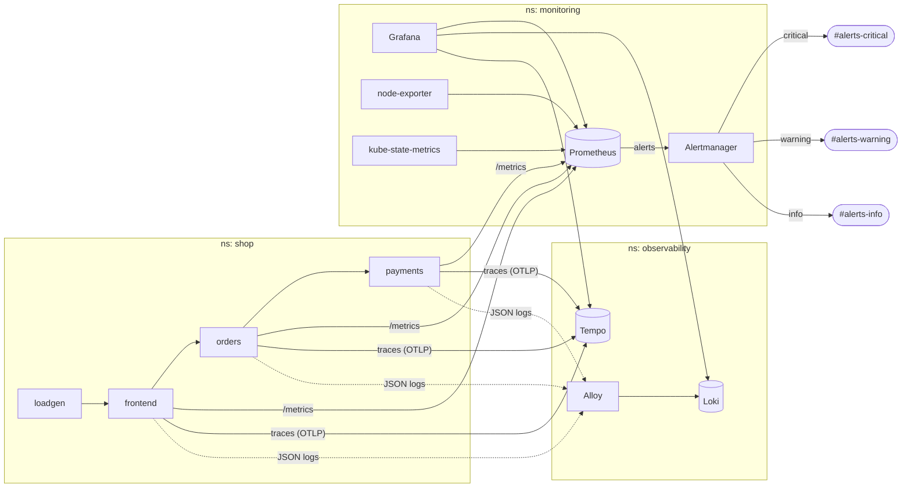
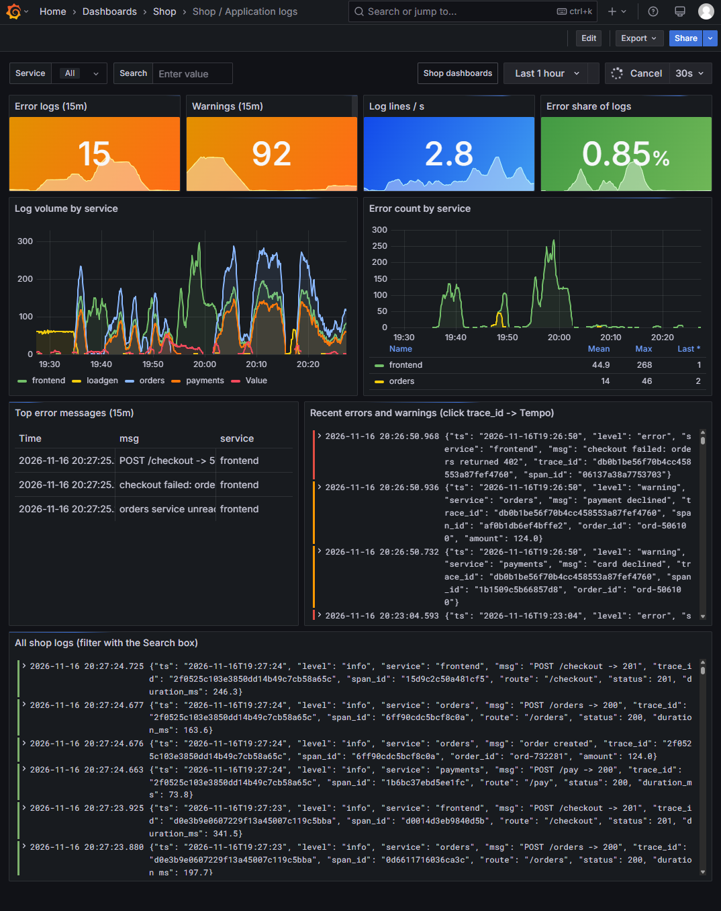

# Observability Platform

Metrics, logs, traces, dashboards and alerts for a small microservices app. The goal is that when something breaks, you can go from the alert to the dashboard, then the logs, then the trace, and find the cause quickly.

The app is a little "shop" I wrote in Python (Flask): `frontend` calls `orders`, which calls `payments`. A `loadgen` pod sends traffic so the dashboards always have something to show.

## Stack

| What | Tool | Namespace |
|---|---|---|
| Metrics and alerts | Prometheus + Alertmanager (kube-prometheus-stack), node-exporter, kube-state-metrics | `monitoring` |
| Dashboards | Grafana | `monitoring` |
| Logs | Loki, with Grafana Alloy collecting them | `observability` |
| Traces | Tempo (the app sends spans over OTLP) | `observability` |
| App | frontend, orders, payments, loadgen | `shop` |

## Architecture



Every log line has a `trace_id`, so in Grafana you can click from a log line to its trace in Tempo, and from a trace back to its logs.

## Repo layout

```
app/                  the shop app (metrics, traces, JSON logs, fault injection)
helm/                 values for kube-prometheus-stack, loki, tempo, alloy
manifests/            namespaces, app deployments, ServiceMonitor, alert rules
dashboards/           Grafana dashboard JSON (loaded as ConfigMaps)
runbooks/             one runbook per alert
tests/                promtool unit tests for the alerts
scripts/              setup, chaos (break things on purpose), alert tests, teardown
kind/                 kind cluster config
```

## Setup

You need Docker, kind, kubectl, Helm and openssl. On Windows, use Git Bash.

```bash
bash scripts/setup.sh
```

This creates a kind cluster called `obs`, generates the Grafana admin password, installs everything with Helm, builds the app image, and loads the dashboards and alert rules. It takes around 10–15 minutes, depending on how fast the images download.

Open the UIs:

```bash
kubectl -n monitoring get secret grafana-admin -o jsonpath='{.data.admin-password}' | base64 -d; echo
kubectl -n monitoring port-forward svc/kps-grafana 3000:80        # http://localhost:3000 (user: admin)
kubectl -n monitoring port-forward svc/kps-prometheus 9090
kubectl -n monitoring port-forward svc/kps-alertmanager 9093
```

The dashboards are in Grafana under **Dashboards → Shop**.

To delete everything: `bash scripts/teardown.sh`

## Dashboards

| Dashboard | Shows |
|---|---|
| Service overview | Request rate, error rate and p50/p95/p99 latency per service (RED), plus orders, revenue and success rate |
| Infrastructure | Node CPU, memory, disk, disk I/O, network, and pod restarts |
| Application logs | Error and warning counts, log volume per service, top errors, recent error lines |
| SLO (bonus) | 99.5% availability target, error budget left, burn rate |

The JSON files in `dashboards/` are generated by `scripts/build_dashboards.py`.

## Alerts

Rules are in `manifests/alerting/shop-rules.yaml`. Each one has a severity label, a summary, a description and a runbook link.

| Alert | Fires when | Severity | Runbook |
|---|---|---|---|
| HighErrorRate | more than 5% of requests return 5xx for 5 min | critical | [high-error-rate](runbooks/high-error-rate.md) |
| HighLatencyP99 | p99 latency above 1s for 5 min | warning | [high-latency](runbooks/high-latency.md) |
| PodCrashLooping | more than 3 restarts in 1 hour | warning | [pod-crashlooping](runbooks/pod-crashlooping.md) |
| NodeNotReady | a node isn't Ready for 5 min | critical | [node-not-ready](runbooks/node-not-ready.md) |
| DiskSpaceLow | less than 10% disk free for 5 min | warning | [disk-space-low](runbooks/disk-space-low.md) |
| DiskSpaceCritical | less than 5% disk free for 5 min | critical | [disk-space-low](runbooks/disk-space-low.md) |
| ServiceDown | Prometheus can't scrape a service for 2 min | critical | [service-down](runbooks/service-down.md) |
| SLOErrorBudgetBurnFast | burning the error budget 14.4x too fast | critical | [slo-burn-rate](runbooks/slo-burn-rate.md) |
| SLOErrorBudgetBurnSlow | burning the error budget 6x too fast | warning | [slo-burn-rate](runbooks/slo-burn-rate.md) |
| PaymentDeclinesElevated | more than 5% of payments declined for 15 min | info | [payment-declines](runbooks/payment-declines.md) |

**Routing** is set in Alertmanager (`helm/kube-prometheus-stack-values.yaml`):

- critical → `#alerts-critical`, repeats every hour
- warning → `#alerts-warning`, repeats every 4 hours
- info → `#alerts-info`, once a day

A critical alert mutes the warning for the same service, so you don't get paged twice for one problem. The Slack webhook comes from a Secret; pass `SLACK_WEBHOOK_URL=... bash scripts/setup.sh` to connect a real channel. There's also a PagerDuty receiver in the values file, commented out until you add a routing key.

### Testing the alerts

Unit tests, no cluster needed (runs promtool locally, or in Docker if you don't have it):

```bash
bash scripts/test-alerts.sh
```

On the running cluster, you can break things on purpose:

```bash
bash scripts/chaos.sh errors     # payments returns 30% errors  -> HighErrorRate
bash scripts/chaos.sh latency    # orders gets 1.5s slower      -> HighLatencyP99
bash scripts/chaos.sh crash      # orders crashes on start      -> PodCrashLooping
bash scripts/chaos.sh reset      # put everything back
```

NodeNotReady and the disk alerts are only covered by the unit tests. The cluster is a single node, so stopping it would also stop Prometheus. Filling the disk would fill Docker's own disk.

## Security

- **Grafana:** no default password. The admin password is generated at install time and kept only in a Kubernetes Secret. Anonymous access and sign-up are turned off.
- **Prometheus RBAC:** Prometheus runs under its own service account, with read-only cluster access (get/list/watch).
- **No secrets in Git:** the Grafana password and Slack webhook are both created as Secrets by the setup script.
- **Nothing exposed publicly:** all the UIs are ClusterIP services, reached with `kubectl port-forward`.
- **App pods:** they run as non-root with a read-only filesystem, drop all capabilities, and don't mount a service account token. The `shop` namespace enforces the `restricted` Pod Security level.

## Resource usage

I ran this on a 7 GB laptop (Docker/WSL capped at 5 GB), so everything is sized small:

| Component | Memory (request / limit) | Retention |
|---|---|---|
| Prometheus | 384Mi / 768Mi | 2 days |
| Grafana 11.6 | 192Mi / 512Mi | stateless, everything provisioned from the repo |
| Loki | 192Mi / 512Mi | 3 days |
| Tempo | 128Mi / 384Mi | 24 hours |
| Alloy | 96Mi / 256Mi | |
| Each shop service | 96Mi / 256Mi | |

Other ways I kept the load down: one replica per service, Prometheus scraping every 30s, Alloy collecting logs only from the `shop` namespace, and the load generator sending 2 requests a second.

**Note:** everything deployed, but the laptop really struggled. CPU was at 270–700%, and the Kubernetes API kept timing out, so Grafana often showed "No data" because its queries timed out. That's a hardware limit, not a config problem. On a proper machine (a 16 GB EC2 instance, for example) or a managed cluster, the same files work as they are. The alert logic is proven separately by the promtool tests.

## Bonus

- SLO dashboard with error budget and burn-rate alerts
- Custom business metrics: orders, revenue, cart value and payment failures, plus an info alert on payment declines
- Log ↔ trace correlation in Grafana (Loki derived field to Tempo, and Tempo traces-to-logs back to Loki)
- On-call: severity-based routing is in place; the PagerDuty receiver is ready but needs a routing key

## Screenshot

The Application logs dashboard in Grafana, with logs from the shop services coming through Loki:



